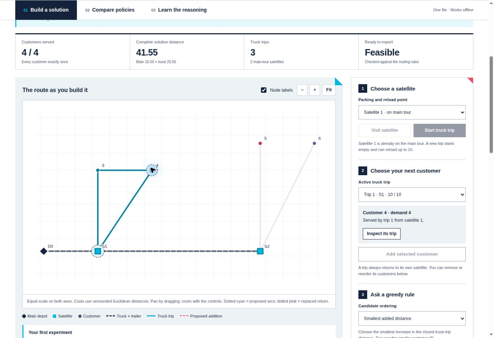

# STTRPSD course project tools

This repository supports the **Single Truck and Trailer Routing Problem with Satellite Depots** used in the combinatorial optimization project. It contains an independent solution checker, simple feasible constructors, ten practice instances, a benchmark runner, and an HTML report that works offline. Students can write their solver in any language that reads the canonical instance JSON and writes the required solution JSON.

The original benchmark uses **unrounded Euclidean distances**. Every customer is accessible only to the truck. The truck and trailer travel together from the main depot through selected satellite depots and back. At a satellite, the truck can make several capacity-feasible customer trips; every such trip returns to the same satellite before the vehicle continues.

## Requirements

- Python **3.10 or newer** for the supplied tools.
- No third-party Python packages and no `pip install` step.
- A modern web browser to open the generated HTML report.
- A separate runtime/compiler only if your own solver needs one.

## Get the complete project

```bash
git clone https://github.com/twktheainur/imtma-2ia-combinopt2026.git
cd imtma-2ia-combinopt2026
```

Alternatively, use GitHub's **Code → Download ZIP**, then **extract the entire ZIP** before running anything. On Windows, use **Extract All…**; do not run files from the ZIP preview or extract only `sttrpsd/`. The downloaded folder may be named `imtma-2ia-combinopt2026-main`.

The **project root** is the folder containing this `README.md` together with `sttrpsd/`, `scripts/`, `examples/`, `configs/`, and `instances/`. Open a terminal in that folder. If changing folders manually, quote the complete path, especially if it contains spaces:

```powershell
Set-Location -LiteralPath "C:\path to your project\imtma-2ia-combinopt2026-main"
```

Replace that example with the actual extracted folder. On macOS/Linux, use `cd "/path to your project/imtma-2ia-combinopt2026-main"`.

## Quick start

### Windows PowerShell

Check that Python is version 3.10 or newer, then run the supplied quick-start script:

```powershell
py -3 --version
py -3 scripts/quickstart.py
```

The script finds the project from its own location, uses the same Python interpreter for both commands, constructs `output/toy_baseline.json`, then scores **that exact file** and writes `output/toy_score.json`. It stops before scoring if construction fails or its output is missing. If you invoke the script by its full quoted path, it also works from another working directory:

```powershell
py -3 "C:\path to your project\imtma-2ia-combinopt2026-main\scripts\quickstart.py"
```

To run the two commands yourself, use these **from the project root**. Run each displayed line as one command, and run `score` only after `baseline` succeeds:

```powershell
py -3 -m sttrpsd baseline --instance "examples/toy.json" --solution "output/toy_baseline.json" --method nearest --seed 0 --time-limit 30
py -3 -m sttrpsd score --instance "examples/toy.json" --solution "output/toy_baseline.json" --output "output/toy_score.json"
```

### macOS / Linux

```bash
python3 --version
python3 scripts/quickstart.py
```

Or run the same two commands explicitly from the project root:

```bash
python3 -m sttrpsd baseline --instance "examples/toy.json" --solution "output/toy_baseline.json" --method nearest --seed 0 --time-limit 30
python3 -m sttrpsd score --instance "examples/toy.json" --solution "output/toy_baseline.json" --output "output/toy_score.json"
```

Successful construction prints the absolute path of the solution it wrote. Successful scoring prints JSON with `"feasible": true`, a numeric `"cost"`, and an empty `"errors"` array. `output/toy_baseline.json` is the **routing solution**; `output/toy_score.json` is the **evaluation result**. These are different formats. Do not pass the score result back as `--solution`.

**The scorer reads exactly the file named by `--solution`.** It does not create a solution, run a solver, or search other directories for one. The included `examples/toy_solution.json` is a separate worked solution that can also be scored directly. For your own solver, first write its solution to an explicit path, then pass the same path to `score`.

Forward slashes in the examples work with these Python tools on Windows too. Keep paths containing spaces inside straight quotes. For the commands elsewhere in this README, replace the `python3` prefix with `py -3` in PowerShell. If your installation provides a different Python 3 command, verify its version first and use it consistently.

### Run a comparison and open its HTML report

Windows PowerShell:

```powershell
py -3 -m sttrpsd benchmark --config "configs/public.json" --output "output/public_run"
Start-Process "output/public_run/report.html"
```

macOS/Linux:

```bash
python3 -m sttrpsd benchmark --config "configs/public.json" --output "output/public_run"
```

Then open `output/public_run/report.html` in your browser. `configs/public.json` compares the Session 1 starter constructors on the ten practice instances, keeping the nearest-neighbour reference outside the ranking. `configs/demo.json` compares the same constructors with both included in its illustrative ranking. A pre-generated report is available at `demo/demo_report.html`.

Every benchmark output directory must be **new**. To repeat an experiment, choose another directory such as `output/public_run_02`. This prevents an old solution file from being mistaken for a new submission.

To regenerate only the HTML from a completed experiment:

```bash
python3 -m sttrpsd report --results "output/public_run/results.json" --output "output/public_report.html"
```

The constructors are starting points for **Session 1, greedy methods**. `nearest` chooses one satellite using a star-distance estimate, then forms capacity-feasible nearest-neighbour trips. `random` provides a simple comparison by choosing a satellite and feasible customer additions using the supplied seed. Both stop after construction. The `--time-limit` argument supports the common solver interface; the benchmark runner enforces the fixed **30-second** wall-clock deadline.

### Troubleshooting paths and Windows commands

| Symptom | What to check |
| --- | --- |
| `py` is not recognized | Install Python 3.10 or newer with its Windows launcher, or use `python` after `python --version` confirms a suitable Python 3 installation. Reopen PowerShell after installation. |
| `No module named sttrpsd` | The direct `-m sttrpsd` command must run from the project root. In PowerShell, run `Get-Location` and `Test-Path -LiteralPath "sttrpsd/__main__.py"`; the second command must print `True`. The quick-start script can instead be invoked by its full path. |
| Python cannot open `scripts/quickstart.py` | You are outside the project root, or the ZIP was not fully extracted. Change to the folder containing both `scripts/` and `sttrpsd/`, or pass the full quoted path to the script. |
| Instance or solution file is missing | Read the reported path, check the current directory, and confirm that the filename and extension match exactly. In PowerShell, `Test-Path -LiteralPath "output/toy_baseline.json"` must print `True` after a successful baseline run. `score` never creates this file. |
| `baseline` failed, or the file is absent afterward | Read that command's error before running `score`. Check that the instance exists and the output folder is writable. The quick-start script performs this check automatically. |
| The scorer says the input has the wrong fields | Pass the routing solution, such as `output/toy_baseline.json`, not `output/toy_score.json`, a benchmark `results.json`, or an instance file. If editing JSON on Windows, save as UTF-8. |
| JSON text cannot be decoded | Save JSON as UTF-8. An optional UTF-8 byte-order mark is accepted; UTF-16 is not supported. Older PowerShell redirection can choose a different encoding, so let your solver write the requested solution file directly. |
| A path with spaces is split into several arguments | Put the entire path in straight quotes, for example `--solution "output/my solution.json"`. In a harness configuration, keep each argument as a separate JSON array entry. |
| A benchmark output directory already exists | Pick a fresh `--output` directory, such as `output/public_run_02`. The runner deliberately refuses to reuse one. |

PowerShell's `$LASTEXITCODE` immediately after a Python command shows its exit status: `0` means success; `score` uses `2` for invalid input or an infeasible solution. Do not continue with a failed construction simply because an older file happens to be present. If asking for help, include the exact command, the error text, the Python version, and the working directory.

## Interactive greedy route lab

Open **[interactive/greedy_lab.html](interactive/greedy_lab.html)** in a modern browser. Download the file first (GitHub's **Download raw file** button), or open it from the extracted repository. It is a self-contained HTML5/JavaScript application: the logo, interface, routing engine, worked example and all ten public instances are embedded. It works offline and requires no installation or server.



The lab supports three complementary activities:

- **Build a solution:** select a satellite, start a truck trip and add customers manually. Inspect the proposed arcs, marginal distance, demand and remaining capacity before committing. Reorder the main tour or a truck trip, move customers between trips, change a trip's satellite, and undo or redo edits.
- **Compare policies:** compare nearest neighbour, cheapest closed-trip addition, addition per unit demand, largest demand first, farthest from satellite, and append-based savings. Run the same six rules on one instance or on all ten public instances. Customer assignments and the main-tour rule remain fixed within each comparison; the tables show complete objective values and equally weighted relative costs, rather than an optimality claim or course mark. Results can be downloaded as CSV.
- **Learn the reasoning:** follow worked calculations and an empirical worksheet connecting greedy choices to load packing, the return leg, satellite selection and subsequent local search.

Import a canonical instance JSON or an original benchmark `.dat` file to work on another instance. **Save workspace** keeps the current instance, draft and named designs in a downloadable JSON file; reopen it to continue later. Browser-session work is not automatically saved to disk. **Export feasible solution** is enabled only after all routing checks pass and writes the exact format accepted by the Python scorer. For example, after saving a toy solution in `output/toy_manual_solution.json`, run:

```bash
python3 -m sttrpsd score --instance "examples/toy.json" --solution "output/toy_manual_solution.json"
```

In Windows PowerShell, use `py -3` instead of `python3`. Partial plans are labelled as drafts and their distance is not a final score. The JavaScript demonstrations are deterministic constructors; use the Python benchmark harness for the course's **30-second** executable-solver evaluation. The lab's engine is checked against the independent Python scorer, including all six policies and both general satellite rules on the ten public instances.

## Project progression

| Session | Main task | Evidence to keep |
| --- | --- | --- |
| **1 — Greedy methods** | Implement a feasible constructive heuristic. Explain the satellite-selection rule, customer order, and capacity handling. | Validated solutions, baseline objectives, and runtimes on the public instances. |
| **2 — Local search** | Improve the greedy solutions with neighbourhood moves such as relocation, exchange, or 2-opt. Check feasibility and stopping conditions. | A controlled comparison with the Session 1 constructor under the same 30-second budget and seeds. |
| **3 — More advanced metaheuristics** | Develop a search strategy that can escape local optima, using the studied nature-inspired method or another justified metaheuristic. | Repeated experiments, an analysis of the added search mechanism, and the final reproducible configuration. |

The supplied constructors leave local search and the advanced metaheuristic for the team to design and implement. Keep each stage as an identifiable method so that the report can explain which changes produced the observed gains.

## What the scorer checks

The solution must satisfy all of the following:

1. The main route begins and ends at the main depot. Its interior contains satellites only, with no satellite repeated.
2. Every truck-only trip is rooted at an existing satellite that appears on the main route. Its implicit start and end are that same satellite.
3. Every customer appears in exactly one truck-only trip. Satellites and the main depot cannot appear in a truck trip's customer list.
4. The sum of customer demands in each truck-only trip does not exceed truck capacity.
5. All required fields, IDs and values follow the data contract.

The instance loader also checks that each individual demand fits the truck and that total demand does not exceed **truck capacity plus trailer capacity**. Satellite depots have no separate capacity, and there is no bound on the number of trips from a satellite. A main route may include a satellite with no assigned trip; any resulting travel is charged.

The scorer computes the complete objective itself:

\[
\text{total cost}=\text{main-route cost}+\sum_{\text{truck trips}}\text{closed-trip cost}.
\]

Both directions are charged for a main route containing one satellite and for a truck trip containing one customer. The scorer does not accept an `objective` or `cost` supplied by a solver. Store optional descriptive information under `metadata`.

Capacity comparisons use tolerance `1e-9 * max(1, capacity)`. Distances are not rounded in the original benchmark. An invalid solution has `feasible: false`, `cost: null`, and diagnostic messages. Its missing or infeasible work is never converted into an apparently attractive travel cost.

`score` prints JSON and returns process exit code **0 for a feasible solution** and **2 for invalid input or an infeasible solution**. The travel objective is not a course mark; the benchmark harness computes the separate ranking mark.

## Canonical instance JSON

The course JSON is an explicit adapter for the original benchmark text files. It is not presented as the VRP-REP XML standard.

```json
{
  "schema_version": 1,
  "name": "tiny-example",
  "depot": {"id": 0, "x": 0, "y": 0},
  "satellites": [{"id": 1, "x": 2, "y": 0}],
  "customers": [{"id": 2, "x": 2, "y": 3, "demand": 6}],
  "truck_capacity": 10,
  "trailer_capacity": 0,
  "distance": {"type": "euclidean"}
}
```

| Field | Meaning |
| --- | --- |
| `schema_version` | Integer `1`. |
| `name` | Unique instance name. Copy it exactly into the solution. |
| `depot` | Main depot with integer ID and finite coordinates. |
| `satellites` | Nonempty array of satellite depots. |
| `customers` | Nonempty array of customers with strictly positive demands. |
| `truck_capacity` | Strictly positive capacity of the truck alone. |
| `trailer_capacity` | Nonnegative trailer capacity. |
| `distance.type` | `euclidean` for the supplied original benchmark. |
| `metadata` | Optional provenance or descriptive information. |

Node IDs are unique integers. Converted original files use depot `0`, satellites `1` through `p`, and customers `p+1` through `p+n`. Solvers should read IDs and node categories from the file rather than assume that array positions are IDs. Coordinates may coincide and need not lie in a particular box.

The checker also supports explicitly requested custom metrics: `rounded_euclidean` uses `floor(distance + 0.5)`, and `explicit` uses a symmetric nonnegative matrix together with a `node_order` array. These are available for custom tests; they do not change the distance convention of the supplied benchmark. The structural schema is in `schemas/instance.schema.json`, with additional semantic checks in the loader.

## Required solution JSON

For the small instance above, a complete solution is:

```json
{
  "schema_version": 1,
  "instance": "tiny-example",
  "main_route": [0, 1, 0],
  "truck_routes": [
    {"satellite": 1, "customers": [2]}
  ],
  "metadata": {"method": "my method", "seed": 0}
}
```

This solution costs `4 + 6 = 10`. A truck route records the satellite once and only customer IDs in its `customers` list. Its return to the named satellite is implicit. Empty truck routes are invalid. Multiple entries may use the same satellite. The order of truck routes in the file does not change the objective; the order of customers within a route does.

The required top-level fields are `schema_version`, `instance`, `main_route`, and `truck_routes`. Only `metadata` is optional. The schema is in `schemas/solution.schema.json`. JSON duplicate keys, `NaN`, infinity, Boolean IDs, and unknown fields are rejected. The Python checker is authoritative for both the structural and routing constraints.

## Connecting your solver

Your program should accept four arguments:

```bash
python3 my_solver.py --instance INPUT.json --solution OUTPUT.json --seed 0 --time-limit 30
```

Read the supplied input path, use the seed for your random choices, and write a complete solution at the supplied output path. Exit with status 0 before the deadline. A deterministic method may ignore the seed while retaining the argument. Write your final solution atomically when possible, and leave a small time margin for file writing and process exit. Logs belong on standard output or standard error, not inside the solution JSON.

The runner also supports compiled programs, for example an executable command beginning with `./solver`, and different flag names through its configurable command array. It does not require a particular programming language.

Add your solver to a copy of `configs/public.json`. A solver entry has this structure when the configuration is in `configs/` and your script is in the project root:

```json
{
  "name": "Group 1",
  "cwd": "..",
  "command": [
    "{python}", "my_solver.py",
    "--instance", "{instance}",
    "--solution", "{solution}",
    "--seed", "{seed}",
    "--time-limit", "{time_limit}"
  ],
  "include_in_ranking": true
}
```

The four run placeholders are substituted separately in each argument. `{python}` expands to the exact Python interpreter running the harness, which is how the shipped Python examples remain portable. Compiled solvers and other languages can use their own executable paths. The command is executed without a shell. Use an array of arguments, not a single shell command string. Literal braces within an argument need doubling as `{{` and `}}`.

Paths in a configuration are relative to **that configuration's directory**. `cwd` controls the solver's working directory. An explicit executable path containing a slash is also resolved against the configuration directory. Script arguments are interpreted by the solver relative to `cwd`. The `{python}` placeholder already selects the current interpreter and needs no platform-specific alias change.

A complete configuration requires `schema_version: 1`, exactly one of `instances` or `instance_glob`, and a nonempty `solvers` array. Optional settings include `title`, `seeds`, `time_limit`, `baseline_name`, `notes`, and an `environment` description. `instances` is an explicit list of paths; `instance_glob` is a relative glob such as `../instances/public/*.json`. The course uses three seeds, `[0, 1, 2]`, and a fixed **30 seconds per run**. All supplied configurations record `"time_limit": 30`; the CLI and harness also use 30 seconds when no explicit value is present. Keep this value for all course comparisons and assessment runs.

For a comparison baseline, set `include_in_ranking` to `false`; setting `baseline_name` alone does not exclude a method from grading. At least one method must participate in the ranking.

## Experimental protocol and ranking

The evaluation budget is fixed at **30 seconds per instance and seed**, with seeds **0, 1, and 2**. The same configuration and machine apply to every team. Seven teams, ten instances and three seeds give 210 solver runs and a maximum of **105 minutes of allocated solver time**, plus scoring and reporting overhead. Baseline runs, when included, add their own runtime.

The runner executes one solver at a time and rotates the solver order across instance/seed cells. On supported Linux systems it pins each solver to one CPU; it also sets common numerical-library thread settings to one. The report records the operating environment. The deadline measures wall-clock time including process startup. A timeout or nonzero exit is a failed run even if the program left a solution file.

For each instance and seed, let `reference` be the lowest feasible cost observed among participating teams. The run score is:

- `reference / own_cost` for a feasible run with positive reference cost, capped at 1.
- `1` when both reference and own cost are zero, and `0` for positive own cost with zero reference.
- `0` for a missing, malformed, infeasible, timed-out or failed run.

If no team has a feasible result for a cell, every team receives zero for that cell. Every scheduled instance/seed cell remains in the denominator. The **ranking mark out of 8** is eight times the mean run score. Thus instance sizes have equal weight, and failures are retained rather than dropped from the average. Equal aggregate scores within an absolute tolerance of `1e-9` share a rank, using competition ranks such as `1, 1, 3`.

These reference costs are **best observed results in this comparison**, not proven optima. They depend on the participating methods. An excluded baseline does not affect the marks. A comparison conducted with only one participating method gives that method full score on every feasible cell, so a practice score alone does not predict the final ranking mark.

The course's overall grade uses the raw component marks:

\[
\text{final mark out of 20}=(P+C+R+K)/2,
\]

where participation `P` is out of 20, code `C` is out of 4, report `R` is out of 8, and ranking `K` is out of 8. The harness calculates `K`; it does not assess participation, code quality, or report quality. See the project statement for those expectations and the lecturer's announced final evaluation settings.

## Report contents and recorded evidence

Each completed campaign produces:

| Output | Contents |
| --- | --- |
| `report.html` | Self-contained interactive ranking, route viewer, per-run comparisons, and diagnostics. Open it directly in a browser. |
| `results.json` | Full run data, embedded instances and solutions, experiment configuration, hashes, environment, scoring rule and leaderboard. |
| `results.csv` | Flat per-run table for further analysis. |
| `runs/` | Individual solution files and bounded standard-output/error logs. |

The HTML contains its own scripts, styles, institutional artwork, and data. It uses no CDN or remote charting library. You can filter runs, inspect routes, and export data without an internet connection. File hashes identify the evaluated instance and solution bytes. Report costs and gaps always refer to validated solutions. Per-instance summaries show feasible-run mean cost, population standard deviation, best cost, and the number of feasible runs.

The harness accepts regular solution files up to **10 MiB** and rejects symbolic links or nonregular outputs. It keeps at most 64 KiB from each standard-output and standard-error stream, with a truncation notice when needed. These limits are substantially above the space needed to represent a route in this benchmark.

Programs run under time limits, but the harness is **not a security sandbox**. The lecturer should run unfamiliar submissions in a suitable dedicated account or container. Submitted programs should use a single CPU, avoid network access during evaluation, and operate only on the supplied instance and their own output files.

## Comparing existing solution files

For analysis without executing a solver, replace a solver's `command` with `solutions_dir`:

```json
{
  "name": "Saved method",
  "solutions_dir": "../saved_solutions",
  "include_in_ranking": true
}
```

The expected relative path is `<instance name>/seed_<seed>.json` under that directory. All files are independently checked. Missing files score zero. Imported solutions have no measured runtime and cannot establish compliance with an execution budget; use executable evaluation for the final timed assessment.

## Original-format conversion

The importer supports the original Villegas benchmark format:

1. First line: number of customers `n`, followed by the number of **all depots**, including the main depot (`p+1`).
2. Second line: truck capacity and trailer capacity.
3. The next `p+1` lines: depot coordinates `x y`, with the main depot first.
4. The next `n` lines: customer coordinates and demand `x y q`.

```bash
python3 -m sttrpsd convert --input "path/to/original.dat" --output "output/converted.json"
```

Conversion preserves the original unrounded Euclidean convention and records the input filename and SHA-256 hash. The parser validates the row counts and numeric fields; it does not guess a different file format.

## Public and private course material

This public repository contains the ten practice instances, their public provenance, student teaching materials, and the tools needed to construct, score and compare solutions. The lecturer keeps the held-out assessment selection, final evaluation configuration, split utility and instructor guide separately. They are not needed for the quick start or the public benchmark commands above. The CLI's `split` command is reserved for that separate instructor distribution.

## Verification

Run the supplied regression checks from the project root. Windows PowerShell:

```powershell
py -3 -m unittest discover -s tests -v
```

macOS/Linux:

```bash
python3 -m unittest discover -s tests -v
```

The tests cover valid and invalid routing structures, capacity boundaries, singleton round trips, malformed input, metric conventions, original-format import, ranking behaviour, process execution failures, and the command-line file workflow. The check over all 32 original source files is skipped when the instructor dataset is absent. Tests for POSIX-only process handling are explicitly skipped on Windows. These tests verify the supplied evaluator; students should also check the feasibility and expected behaviour of their own algorithm changes.

[GitHub Actions](https://github.com/twktheainur/imtma-2ia-combinopt2026/actions/workflows/tests.yml) runs the suite on **Windows and Ubuntu with Python 3.10 and 3.13**. Each matrix job also executes a real baseline → score pipeline in a temporary project directory whose input and output paths contain spaces, and verifies that both commands agree on the solution's cost. The workflow installs no third-party Python packages.

## Sources

- Villegas, J. G., Prins, C., Prodhon, C., Medaglia, A. L., and Velasco, N. (2010). *GRASP/VND and multi-start evolutionary local search for the single truck and trailer routing problem with satellite depots*. Engineering Applications of Artificial Intelligence, 23(5), 780–794. [DOI: 10.1016/j.engappai.2010.01.013](https://doi.org/10.1016/j.engappai.2010.01.013).
- [Author's benchmark download page](https://juangvillegas.com/download/), including the original instance files and their README.
- [STTRPSD entry on VRP-REP](https://vrp-rep.org/variants/item/sttrpsd.html).

The provided code is course infrastructure. It implements the specified evaluation contract; it does not reproduce the research paper's GRASP/VND or evolutionary local search algorithms.

### Teaching materials

`teaching/slides.tex` is a nine-slide Beamer deck. `teaching/project_statement.tex` presents the routing rules, the greedy/local-search/metaheuristic progression, marking rubrics and experimental protocol. Its integer formulation is an optional didactic appendix; implementing an exact solver is not a project requirement. The corresponding [slides PDF](teaching/slides.pdf) and [project statement PDF](teaching/project_statement.pdf) are included. The instructor guide is kept in the separate instructor distribution.

Compile from the `teaching/` directory using a standard TeX Live or MiKTeX installation. Keep `imt_course.sty`, `bimer_course.sty`, the entire `assets/` directory, and `customIMTbeamer/` beside the sources:

```bash
cd teaching
pdflatex slides.tex
pdflatex slides.tex
pdflatex project_statement.tex
pdflatex project_statement.tex
```

`latexmk -pdf` is an alternative. The slides use the exact `customIMTbeamer` class, themes and logos supplied in the Graphical Models and Bayesian Networks lecture example. Its title page, section headings, footers, native numbering, colours, fonts, and predefined blocks are retained. The template requires its usual LaTeX packages, including Euler/EulerVM, PGFPlots and Tabularray; install any missing packages through your TeX distribution.

The written documents use the BIMER company-report model: a full cyan diagonal cover, navy and pink upper corners, a white institutional-logo area, and white interior pages with cyan headings and pink corner folios. The student statement is single column throughout, including its optional appendix, with 19-mm side margins. The instructor guide retains its two-column prose. Keep the article-specific `bimer_course.sty` alongside `imt_course.sty`.

With XeLaTeX or LuaLaTeX the article style prefers Helvetica, then Arial, then Nimbus Sans, and uses Archer Light for the display face when available. The distributed article PDFs embed Nimbus Sans for body text and Latin Modern Roman for the contrasting serif display, because the complete proprietary fonts were unavailable in the build environment. The slides use the supplied template's font configuration, including Euler mathematics. Asset provenance and font notes are in `teaching/assets/BRAND_NOTES.txt`; the measured BIMER design model is recorded in `teaching/assets/bimer_reference/`. The TikZ figures, geometric covers and all mathematical content are editable.

`demo/demo_report.html` opens directly in a browser and demonstrates the report using the ten practice instances.
